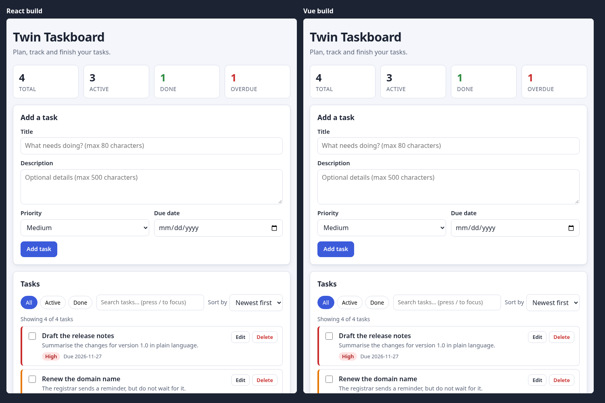
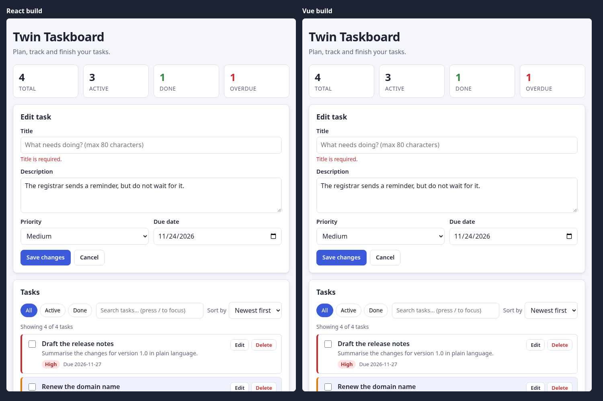
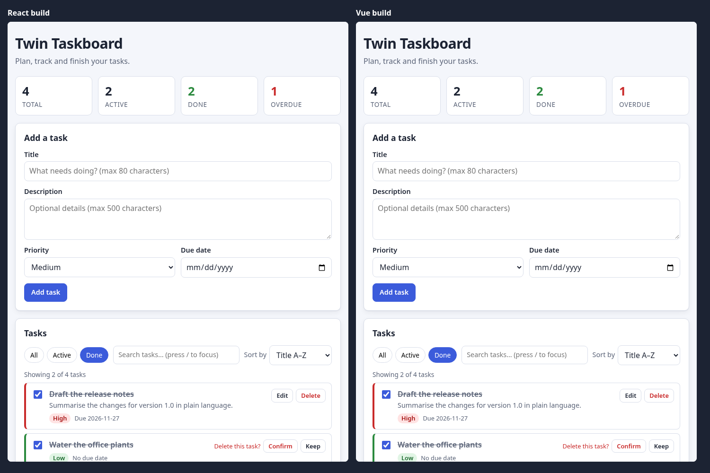
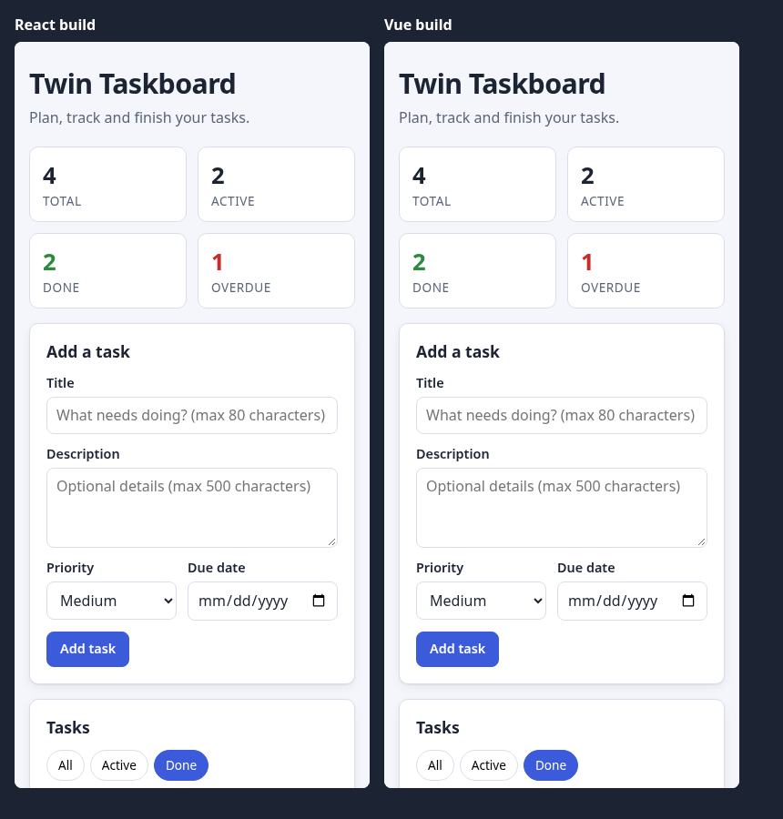
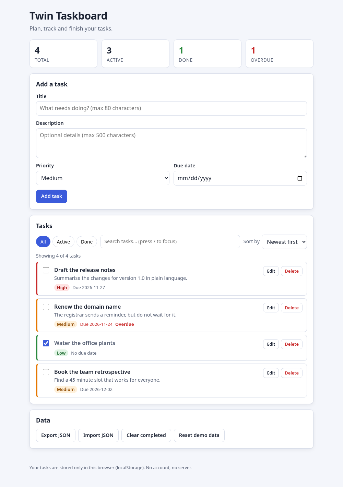

# Twin Taskboard – twin builds

Two completely separate, runnable implementations of the **same** task
tracker: one in **React**, one in **Vue 3**. Same screens, same workflows,
same visible text, same outputs (including the exported JSON) – different
codebases and frameworks. A short functional spec with a traceability matrix
shows how each build meets each requirement.

**Live demo:** <https://moltidenchi.github.io/twin-builds-taskboard/>
· [React build](https://moltidenchi.github.io/twin-builds-taskboard/react/)
· [Vue build](https://moltidenchi.github.io/twin-builds-taskboard/vue/)



## What it does

Add, edit and delete tasks (title, description, priority, due date), mark
them done, filter (All / Active / Done), search, sort, live summary counts
with overdue detection, empty states, form validation, `localStorage`
persistence, JSON export/import, clear completed, reset demo data, keyboard
shortcuts and a responsive layout. The full list is in
[REQUIREMENTS.md](REQUIREMENTS.md) (FR-1 … FR-17).

## Repository layout

| Path | Contents |
| ---- | -------- |
| `react/` | Build A – React 19 + TypeScript + Vite, self-contained npm project |
| `vue/` | Build B – Vue 3 + TypeScript + Vite, self-contained npm project |
| `e2e/` | One Playwright suite run against both builds, plus a DOM parity test |
| `REQUIREMENTS.md` | Functional requirements and traceability matrix |
| `scripts/check-parity.mjs` | Checks that the shared contract files are identical in both builds |
| `site/` | Landing page for GitHub Pages |
| `docs/screenshots/` | Screenshots used in this README |
| `.github/workflows/pages.yml` | CI: type-check, build, unit + e2e tests, deploy to Pages |

## How the two builds differ (and what they share)

| | React build | Vue build |
| - | ----------- | --------- |
| UI framework | React 19, function components + hooks | Vue 3, `<script setup>` single-file components |
| State | `useState` in `App.tsx`, props + callbacks | `useTaskboard` composable (`ref`/`reactive`/`computed`/`watch`), props + emits + `v-model` |
| Persistence hook | `useEffect` | `watch` |
| Components | `Summary`, `TaskForm`, `Toolbar`, `TaskItem`, `DataPanel` | `SummaryStats`, `TaskForm`, `TaskToolbar`, `TaskItem`, `DataPanel` |
| Type-check | `tsc` | `vue-tsc` |
| Component tests | `@testing-library/react` | `@testing-library/vue` |

Each project keeps its **own copy** of three contract files so it stays fully
self-contained: `src/lib/tasks.ts` (framework-free domain logic: validation,
filter/sort, import/export, persistence), `src/styles/app.css` and the
framework-neutral component specs in `src/test/app.behaviour.ts`. Keeping
these byte-identical is what makes the builds indistinguishable, and
`node scripts/check-parity.mjs` (also run in CI) fails if they drift.

### Parity proof

`e2e/tests/parity.spec.ts` opens both builds side by side, drives them through
the same workflow (validation error, add, edit, delete confirmation, toggle,
filter, sort, no-match and empty states) and after every step compares a
normalised DOM snapshot: tags, CSS classes, ARIA/role attributes, form values
and visible text must be identical. It also compares the page title, language
and the full set of loaded CSS rules.

## Requirements

- Node.js 22.22+ or 24.15+ (see `.nvmrc`; CI uses Node 24) and npm
- For e2e tests: Playwright's Chromium (installed with the command below)

## Setup and run

Each build is independent; run either or both.

```bash
# React build – http://localhost:5173
cd react
npm ci
npm run dev

# Vue build – http://localhost:5174
cd vue
npm ci
npm run dev
```

Production build and local preview (React on 4173, Vue on 4174):

```bash
npm run build      # type-check + bundle into dist/
npm run preview
```

## Tests

| Command (run inside the folder) | What it runs |
| ------------------------------- | ------------ |
| `react/`: `npm test` | Vitest: 23 domain tests + 10 component specs = 33 |
| `vue/`: `npm test` | Vitest: the same 23 + 10 specs against the Vue build = 33 |
| `react/` or `vue/`: `npm run typecheck` | `tsc` / `vue-tsc` strict type-check |
| `e2e/`: `npx playwright install chromium` | One-off browser download |
| `e2e/`: `npm test` | Playwright: 14 user flows × 2 builds + 2 parity tests = 30 |
| `e2e/`: `npm run test:react` / `npm run test:vue` | The user flows against one build |
| repo root: `node scripts/check-parity.mjs` | Shared contract files are identical |

The Playwright config builds and previews both apps automatically
(`e2e/playwright-report/` has the HTML report after a run). Run
`npm ci` in `react/` and `vue/` before the e2e suite.

Screenshots are regenerated with `npm run screenshots` in `e2e/` (after
building both apps).

## Screenshots

| | |
| - | - |
|  |  |
| Edit mode with a validation error | Done filter, title sort, delete confirmation |
|  |  |
| Phone width (390 px) | Full page (the Vue version is `vue-overview.png`) |

## Deployment

On every push to `main`, GitHub Actions runs the parity check, type-checks,
builds, runs the unit and e2e suites, then publishes `site/index.html` at the
root of GitHub Pages with the React build under `/react/` and the Vue build
under `/vue/`. Vite uses a relative `base`, so the same bundles also work
from any sub-path or locally.

## Data and privacy

All data stays in the browser's `localStorage`. There is no backend, no
analytics and no external requests. Demo tasks are synthetic.

## Credits

Built with open-source software: [React](https://react.dev),
[Vue](https://vuejs.org), [Vite](https://vite.dev),
[TypeScript](https://www.typescriptlang.org), [Vitest](https://vitest.dev),
[Testing Library](https://testing-library.com),
[jsdom](https://github.com/jsdom/jsdom) and
[Playwright](https://playwright.dev). All are MIT or Apache-2.0 licensed.
Exact versions are pinned in each `package.json` and `package-lock.json`.

## License

[MIT](LICENSE) © 2026 Molti Denchi
